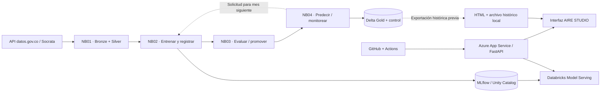

# AIRE STUDIO | Predicción horaria de PM2.5 con MLOps

**Laboratorio de machine learning y MLOps · Databricks + MLflow + GitHub Actions + Azure App Service**

> **Objetivo.** Predecir la concentración de PM2.5 una hora adelante en las estaciones Santa Cruz y San Francisco, y demostrar cómo se supervisa un modelo: entrenamiento, evaluación temporal, promoción de versiones, monitoreo de drift y decisiones de reentrenamiento.


## Resumen del proyecto

| Dimensión | Implementación |
| --- | --- |
| Problema | Regresión de concentración horaria de PM2.5, horizonte de **1 hora** |
| Origen | API pública Socrata de datos.gov.co, recurso `58ct-h586` |
| Ámbito | Estaciones `santa_cruz` y `san_francisco` |
| Experimento | Simulación cronológica: **enero–agosto de 2020** |
| Procesamiento | Cuatro notebooks en Databricks: ingesta → entrenamiento → promoción → monitoreo |
| Registro del modelo | MLflow + Unity Catalog, alias `challenger` y `champion` |
| Almacenamiento | Delta Lake; capas bronze, silver y gold |
| Evaluación | MAE, RMSE y referencia de persistencia (`ŷ[t+1] = PM2.5[t]`) |
| Drift | PSI sobre anomalía `pm25 - mean_24` por estación; KS complementario |
| Presentación | AIRE STUDIO: histórico, gráficos, calendario e invocación del Serving endpoint |
| Publicación web | FastAPI en **Azure App Service** (`Microsoft.Web`), sin Azure Container Apps (`Microsoft.App`) |

### Resultados históricos verificados

- **8 meses** cerrados, cada uno con `prepare`, `train`, `promotion` y `monitor`.
- **11.564 predicciones** guardadas en `gold_predictions`; **19** carecen de objetivo observado para comparar.
- El MAE mensual pasó de **7,570 en marzo** a **2,241 en abril**. Esto es una comparación de meses distintos, **no** una estimación causal aislada del efecto de reentrenar.
- Versiones de champion utilizadas: **v1** (enero–marzo), **v5** (abril), **v6** (mayo) y **v8** (junio–agosto).
- La regla de PSI de la anomalía dio señal de drift en **marzo, abril y mayo**. Una solicitud de entrenamiento no obliga a promover una versión.

[Ver tabla completa de resultados y motivos →](docs/05_RESULTADOS_2020.md)

## Arquitectura en una mirada



**Dos trayectorias diferentes:** Databricks ejecuta y registra la simulación; Azure presenta los resultados históricos ya calculados y, si el endpoint está configurado, solicita una **nueva** predicción al modelo publicado. La web **no inicia Jobs ni reentrena automáticamente**.

## Guía de lectura del repositorio

| Documento | ¿Qué responde? |
| --- | --- |
| [01 · Arquitectura](docs/01_ARQUITECTURA.md) | ¿Qué hace cada plataforma y cómo fluyen los datos? |
| [02 · Metodología MLOps](docs/02_METODOLOGIA_MLOPS.md) | ¿Qué sucede mes a mes y cómo se evita utilizar el futuro? |
| [03 · Datos y variables](docs/03_DATOS_Y_VARIABLES.md) | ¿Cuáles son las 13 entradas y cómo se construyen? |
| [04 · Drift y reentrenamiento](docs/04_DRIFT_REENTRENAMIENTO_Y_PROMOCION.md) | ¿Cuándo se entrena y cuándo se promueve? |
| [05 · Resultados 2020](docs/05_RESULTADOS_2020.md) | ¿Cómo se interpretan las métricas, PSI y cambios de champion? |
| [06 · Manual de la interfaz](docs/06_GUIA_DE_LA_WEB.md) | ¿Qué significa cada tarjeta o cada predicción? |
| [07 · Contratos API](docs/07_API_Y_CONTRATOS.md) | ¿Qué solicita y responde FastAPI? |
| [08 · Despliegue y operación](docs/08_DESPLIEGUE_Y_OPERACION.md) | ¿Cómo subir, publicar, probar y diagnosticar? |
| [09 · Glosario](docs/09_GLOSARIO.md) | Definiciones precisas de ML, datos, estadística y nube |
| [10 · Validación y límites](docs/10_VALIDACION_Y_LIMITACIONES.md) | ¿Qué está verificado, qué no y qué exige producción? |
| [11 · Organización GitHub](docs/11_REPOSITORIO_Y_MANTENIMIENTO.md) | ¿Cómo organizar el repositorio y mantener los archivos? |

## Puesta en marcha local

Necesitas Python compatible con los paquetes de `requirements.txt`, acceso al código y el archivo histórico. Desde la raíz del proyecto, en PowerShell:

```powershell
py -m venv .venv
.\.venv\Scripts\Activate.ps1
python -m pip install -r requirements.txt
python -m uvicorn main:app --reload
```

Abre `http://127.0.0.1:8000/` y verifica `http://127.0.0.1:8000/health`.

La reproducción histórica funciona con `static/index.html` y `data/historical_features_2020.json.gz`. La **nueva inferencia** requiere configurar **solo en el servidor** `DATABRICKS_HOST`, `DATABRICKS_ENDPOINT` y `DATABRICKS_TOKEN` con autorización de consulta al endpoint. **No publiques credenciales en GitHub.**

## Estado y alcance

- **Ejecutado y validado con resultados:** simulación enero–agosto 2020, exportación histórica, API de consulta local y visualización web.
- **Depende de la configuración externa:** consulta real de `/api/history/predict` al Databricks Serving endpoint; verifica el estado `READY` y su **versión desplegada**, que no cambia automáticamente al mover el alias de MLflow.
- **No implementado en la web actual:** ejecución de nuevos Jobs, simulaciones en tiempo real, ingestión continua o actualización automática de los CSV históricos.

**Nota temporal:** los archivos exportados y el calendario web representan fechas con sufijo `Z`/UTC; el notebook de ingesta interpreta las fechas de la fuente sin una conversión explícita de huso horario. Debe validarse el huso de origen antes de usar los sellos temporales como hora civil UTC en una aplicación operativa.

**Ámbito:** demostración académica/histórica; no constituye sistema oficial de alerta sanitaria ni medición ambiental en vivo.
