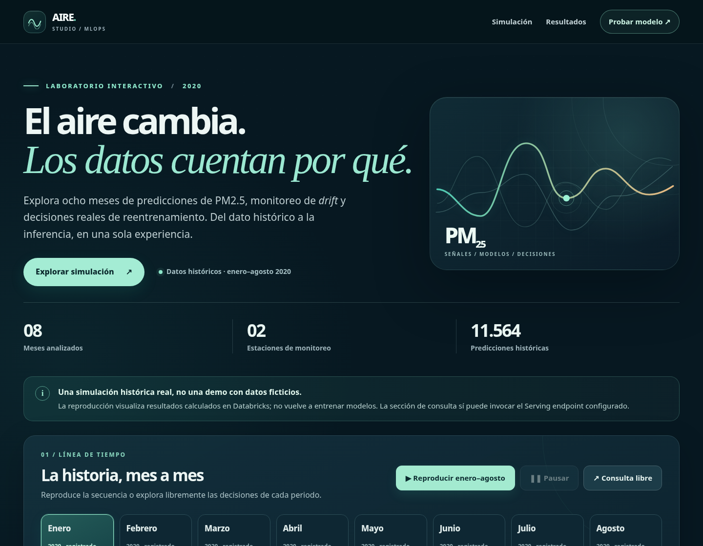
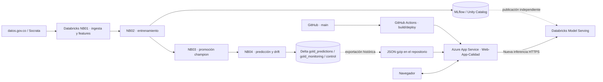

# AIRE STUDIO | Predicción de PM2.5 y ciclo MLOps

**Simulación histórica de enero a agosto de 2020 · Databricks + MLflow + GitHub Actions + Azure App Service**

## Acceder a la aplicación web pública

### **[ABRIR AIRE STUDIO EN AZURE ↗](https://web-app-calidad-d4fvd7f3byc9dtfh.mexicocentral-01.azurewebsites.net/)**

**Dirección directa:** https://web-app-calidad-d4fvd7f3byc9dtfh.mexicocentral-01.azurewebsites.net/  
**Prueba de salud de la API:** [abrir `/health`](https://web-app-calidad-d4fvd7f3byc9dtfh.mexicocentral-01.azurewebsites.net/health)  
**Guía de acceso e interpretación:** [Aplicación web pública](docs/12_APLICACION_WEB_PUBLICA.md)

> **Estado documentado (16 de octubre de 2026):** el workflow de GitHub Actions que publica en Azure terminó correctamente y Azure mostró la Web App en estado `Running`. Aún debe comprobarse, desde un navegador, que la URL pública responde, que `/health` devuelve `{"status":"ok"}` y que la nueva inferencia puede consultar Databricks. Una ejecución verde no equivale a esas tres comprobaciones.



## ¿Qué hace el proyecto?

AIRE STUDIO permite explorar la predicción **una hora adelante de la concentración de PM2.5** en las estaciones **Santa Cruz** y **San Francisco**, a partir de datos históricos publicados en [datos.gov.co](https://www.datos.gov.co/resource/58ct-h586.json). Reproduce una simulación mensual de ocho meses y muestra cómo las reglas de *drift*, degradación del MAE y revisión programada conducen a decisiones de reentrenamiento.

La aplicación también ofrece un calendario de fechas y horas válidas para comparar lo que predijo el **champion histórico**, lo que se **observó realmente una hora después** y, bajo demanda, lo que devuelve **el modelo actualmente publicado en Databricks Model Serving** para las mismas 13 variables.

### Resultados históricos del experimento

| Indicador | Resultado |
| --- | --- |
| Periodo | Enero–agosto de 2020, ocho ciclos cerrados |
| Estaciones | `santa_cruz` y `san_francisco` |
| Etapas por mes | `prepare`, `train`, `promotion`, `monitor` |
| Predicciones exportadas | **11.564** (19 sin observación objetivo disponible) |
| Horas válidas reconstruidas para el calendario | **11.089** |
| Peor MAE mensual | **7,570**, marzo |
| MAE abril | **2,241**, con champion v5 |
| Drift de anomalía | Detectado en marzo, abril y mayo |
| Champion utilizado por mes | v1 enero–marzo; v5 abril; v6 mayo; v8 junio–agosto |

Estas métricas describen la **simulación histórica**, no una evaluación de emisiones o concentraciones en tiempo real. Comparar el MAE entre meses no demuestra por sí solo una mejora causal por el cambio de modelo. [Resultados completos y razones de reentrenamiento →](docs/05_RESULTADOS_2020.md)

## Arquitectura implementada



**Separación de responsabilidades:** Databricks realiza el entrenamiento, el seguimiento de drift y la simulación. GitHub versiona el código y automatiza su publicación. Azure App Service sirve la página AIRE STUDIO y FastAPI. Los resultados históricos se leen de un archivo incluido en la aplicación, **no de consultas en vivo a las tablas Delta**. La web **no inicia nuevos Jobs ni ejecuta reentrenamientos**.

**Versión del modelo:** la simulación terminó usando el champion **v8** en agosto, pero el Serving endpoint puede servir otra versión. La versión realmente desplegada debe verificarse en Databricks; cambiar el alias `champion` no garantiza actualizar el endpoint automáticamente.

[Diagrama detallado y componentes →](docs/01_ARQUITECTURA.md)

## Publicación en Azure y GitHub

| Elemento | Configuración documentada |
| --- | --- |
| Repositorio | [`Fred-0606/MLOPS_Calidad_aire`](https://github.com/Fred-0606/MLOPS_Calidad_aire) |
| Rama de despliegue | `main` |
| Workflow de publicación | `.github/workflows/main_web-app-calidad.yml` |
| Workflow independiente | `Pruebas de la API` (CI de pruebas) |
| Aplicación Azure | `Web-App-Calidad` |
| Grupo de recursos Web App | `Resource_calidad_aire` |
| App Service Plan | `ASP-RecursosStudents-b107` (Free F1), en `Recursos_students` |
| Sistema y región | Linux, Mexico Central |
| Autenticación del workflow | OIDC con identidad administrada de usuario `oidc-msi-9e69` |
| Proveedor Azure | `Microsoft.Web` (sin Azure Container Apps / `Microsoft.App`) |
| Dominio público | [Abrir AIRE STUDIO](https://web-app-calidad-d4fvd7f3byc9dtfh.mexicocentral-01.azurewebsites.net/) |

GitHub Actions informó una publicación satisfactoria el **16/10/2026**, tras resolver la identidad OIDC y esperar la recuperación de una cuota F1 que había dejado el sitio en `Quota exceeded`. La disponibilidad funcional se valida por separado con pruebas HTTP. [Despliegue y diagnóstico →](docs/08_DESPLIEGUE_Y_OPERACION.md)

## Guía de documentación

| Archivo | Qué explica |
| --- | --- |
| [01 · Arquitectura](docs/01_ARQUITECTURA.md) | Componentes y flujo de datos, modelos y despliegue |
| [02 · Metodología MLOps](docs/02_METODOLOGIA_MLOPS.md) | Orquestación secuencial de notebooks y experimentación temporal |
| [03 · Datos y variables](docs/03_DATOS_Y_VARIABLES.md) | Fuente, calidad y las 13 características de entrada |
| [04 · Drift y reentrenamiento](docs/04_DRIFT_REENTRENAMIENTO_Y_PROMOCION.md) | PSI, KS, MAE, gates y champion/challenger |
| [05 · Resultados de 2020](docs/05_RESULTADOS_2020.md) | Métricas por mes y decisiones históricas |
| [06 · Guía de la interfaz](docs/06_GUIA_DE_LA_WEB.md) | Interpretar gráficos y las tres cifras de predicción |
| [07 · API y contratos](docs/07_API_Y_CONTRATOS.md) | Rutas FastAPI y formato `dataframe_split` |
| [08 · Despliegue](docs/08_DESPLIEGUE_Y_OPERACION.md) | GitHub Actions, OIDC, Azure y verificación |
| [09 · Glosario](docs/09_GLOSARIO.md) | Vocabulario técnico y operativo |
| [10 · Validación y límites](docs/10_VALIDACION_Y_LIMITACIONES.md) | Qué está demostrado y qué falta probar |
| [11 · Organización de GitHub](docs/11_REPOSITORIO_Y_MANTENIMIENTO.md) | Estructura y mantenimiento documental |
| **[12 · Aplicación web pública](docs/12_APLICACION_WEB_PUBLICA.md)** | **Acceso directo a la URL, comprobaciones y uso público** |
| [13 · Bitácora de despliegue](docs/13_BITACORA_DESPLIEGUE_2026.md) | Incidencias resueltas y estado de publicación |

## Ejecutar el código localmente

En PowerShell, desde la raíz del proyecto:

```powershell
py -m venv .venv
.\.venv\Scripts\Activate.ps1
python -m pip install -r requirements.txt
python -m uvicorn main:app --reload
```

Abre `http://127.0.0.1:8000/` y `http://127.0.0.1:8000/health`. El calendario necesita `data/historical_features_2020.json.gz`. Para la **nueva inferencia** se configuran en el **servidor**, nunca en el HTML, las variables `DATABRICKS_HOST`, `DATABRICKS_ENDPOINT` y `DATABRICKS_TOKEN`.

## Seguridad, transparencia y limitaciones

- **Acceso público:** mientras no exista autenticación y límites de peticiones, los visitantes pueden provocar consultas al Serving endpoint con posibles costos. El sitio debe tratarse como **demostración académica**, no servicio productivo sin controles.
- **Datos históricos:** no se actualizan automáticamente desde Databricks; volver a exportarlos implica generar y publicar una nueva versión del artefacto.
- **Diferencia entre modelos:** el champion de agosto de 2020 no garantiza la versión que esté atendiendo hoy desde Serving.
- **Zona horaria:** la interfaz emplea marcas `Z` en los registros exportados; debe verificarse la zona de origen antes de interpretar las horas como UTC civil real.
- **Alcance:** la aplicación no predice la calidad del aire en tiempo real, no detecta nuevos drift al pulsar un botón y no reentrena desde Azure.

[Ver validaciones y limitaciones en detalle →](docs/10_VALIDACION_Y_LIMITACIONES.md)
