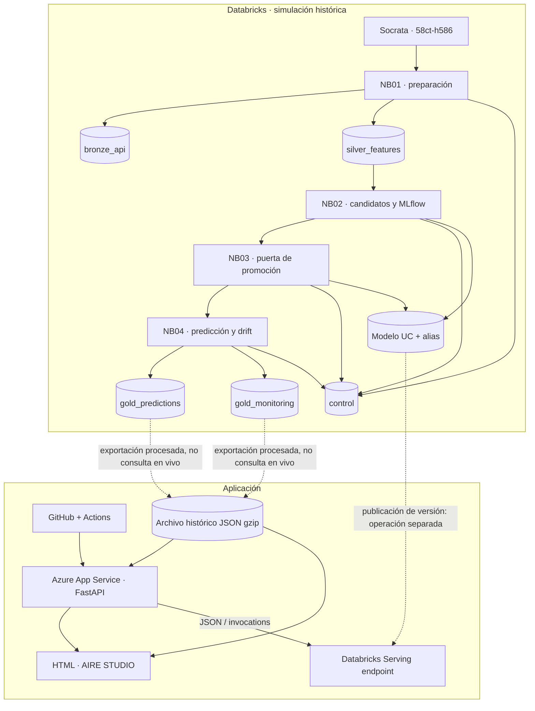
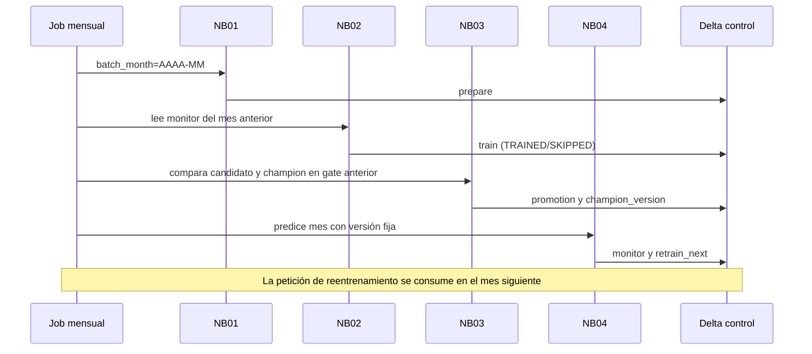
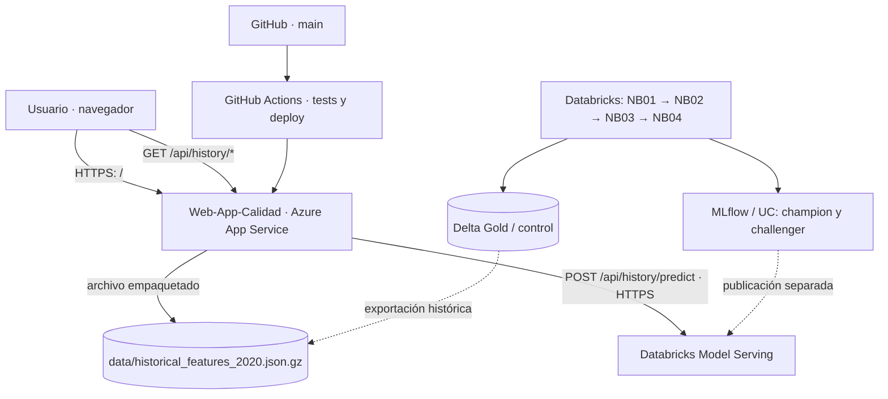

# 01 · Arquitectura del proyecto

[← README](../README.md) · [Metodología →](02_METODOLOGIA_MLOPS.md)

## Acceso público al resultado desplegado

**[Abrir AIRE STUDIO en Azure ↗](https://web-app-calidad-d4fvd7f3byc9dtfh.mexicocentral-01.azurewebsites.net/)** · [Ficha de acceso y pruebas](12_APLICACION_WEB_PUBLICA.md)

El 16/10/2026 GitHub Actions completó su workflow de despliegue sobre `Web-App-Calidad`. La Web App utiliza Linux y un App Service Plan F1, en `Mexico Central`; el workflow en verde no sustituye la validación HTTP de `/health` y del Serving endpoint.

## Separación de responsabilidades

El proyecto tiene **dos ciclos técnicos independientes** y una interfaz que los presenta:

1. **Ciclo del modelo:** Databricks consulta la fuente, materializa tablas Delta, entrena, registra versiones MLflow, decide el champion, genera predicciones y evalúa deriva y errores. Cada mes se cierra antes de procesar el siguiente.
2. **Ciclo del software:** GitHub conserva la aplicación y GitHub Actions despliega FastAPI y el HTML en Azure App Service. Publicar una versión de software no cambia por sí mismo el champion.
3. **Consumo:** el panel lee resultados históricos exportados; la nueva inferencia envía una solicitud desde FastAPI al Databricks Model Serving endpoint que se haya configurado.

### Servicios y artefactos

| Elemento | Función y tecnología | Ubicación lógica |
| --- | --- | --- |
| Fuente Socrata | Lecturas originales de PM2.5 | `www.datos.gov.co/d/58ct-h586` |
| `bronze_api` | Registros liberados, JSON de origen y hora interpretada | `workspace.mlops_aire_demo_2020` |
| `silver_features` | Serie horaria, variables y etiqueta de t+1 | Mismo esquema, Delta Lake |
| `control` | Estado de `prepare`, `train`, `promotion`, `monitor` y `source:anchor` | Mismo esquema |
| `gold_predictions` | Predicción, fecha/hora, estación, etiqueta y versión | Mismo esquema |
| `gold_monitoring` | Métricas y motivos de reentrenamiento del mes, JSON `payload` | Mismo esquema |
| `pm25_una_hora` | Modelos versionados, alias `champion`/`challenger` | Unity Catalog / MLflow |
| Job `MLOPS_AIRE_CICLO_MENSUAL` | Orquesta NB01 → NB02 → NB03 → NB04 | Databricks Workflows |
| Job `MLOPS_AIRE_SIMULACION_2020` | Encadena febrero → agosto; enero ya se ejecutó inicialmente | Databricks Workflows |
| `data/historical_features_2020.json.gz` | Índice de horas consultables para el calendario y entradas reconstruidas | Artefacto **estático** en la app |
| `main.py` | `/health`, proxy `/predict`, endpoints `/api/history/*` | Azure App Service (FastAPI) |
| `static/index.html` | Panel, animación histórica, gráficos, calendario y consultas | Azure App Service |
| GitHub Actions | Compilación/publicación del código, no del modelo | GitHub |

> El nombre de esquema `workspace.mlops_aire_demo_2020` corresponde al experimento descrito. Si se configura otro `catalog` o `schema`, los nombres de tablas y modelo registrados cambian.

## Secuencia y frontera temporal

La tabla `control` conserva eventos persistentes (no variables temporales). Un mes se considera **cerrado** cuando existe `monitor` para ese `batch`. NB01 impide comenzar un mes posterior si no existe el monitoreo del anterior; el encadenamiento entre Jobs también impone esa dependencia.

## Qué significa despliegue aquí

- **`champion` en MLflow:** alias del modelo registrado, movido por NB03 después de una evaluación favorable.
- **Versión servida:** modelo y versión asociados al Serving endpoint. **No hay evidencia en los archivos de que cambiar el alias actualice automáticamente el endpoint**; se debe confirmar su configuración en Databricks.
- **Backend de Azure:** reenvía solicitudes al endpoint que se indique con variables de entorno; no alberga ni entrena el modelo.
- **Sitio web:** consume resultados del histórico empaquetado. No invoca `jobs/run-now` ni lanza simulaciones nuevas.

## Infraestructura de la implementación actual

| Capa | Recurso / configuración |
| --- | --- |
| Código fuente | `Fred-0606/MLOPS_Calidad_aire` (`main`) |
| Publicación automatizada | GitHub Actions: `.github/workflows/main_web-app-calidad.yml` |
| Identidad de despliegue | OIDC, identidad de usuario `oidc-msi-9e69` |
| Web App | `Web-App-Calidad`, grupo `Resource_calidad_aire` |
| Plan | `ASP-RecursosStudents-b107`, Free F1, grupo `Recursos_students` |
| Región y plataforma | Mexico Central; App Service Linux + Python |
| Dominio | [AIRE STUDIO](https://web-app-calidad-d4fvd7f3byc9dtfh.mexicocentral-01.azurewebsites.net/) |
| Modelo / experimentación | Databricks, esquema `workspace.mlops_aire_demo_2020` |
| Datos visualizados | JSON comprimido empaquetado en `data/`, generado desde Delta Gold |

El App Service Plan está compartido con `mlops-students`, otra aplicación. Esto afecta el contexto de operación, pero **no hay evidencia suficiente para atribuirle** el bloqueo temporal por cuota F1 que se presentó durante el despliegue.

La identidad OIDC autentica **GitHub Actions frente a Azure**. Las variables `DATABRICKS_HOST`, `DATABRICKS_ENDPOINT` y `DATABRICKS_TOKEN` se configuran **dentro de la Web App** para la comunicación Azure → Databricks. Son credenciales y flujos distintos.

## Por qué App Service y no Container Apps

El proyecto evita crear recursos de Azure Container Apps, administrados por `Microsoft.App`, debido al bloqueo de registro experimentado. La ruta utilizada para la API es Azure **App Service**, perteneciente al proveedor `Microsoft.Web`; el despliegue desde GitHub Actions y las variables de entorno se gestionan en la Web App. El diseño no necesita ACR, Docker ni Container Apps para correr el backend Python. Esto no garantiza cuotas, acceso o gratuidad del App Service ni del Model Serving.

[Volver al índice](../README.md)
