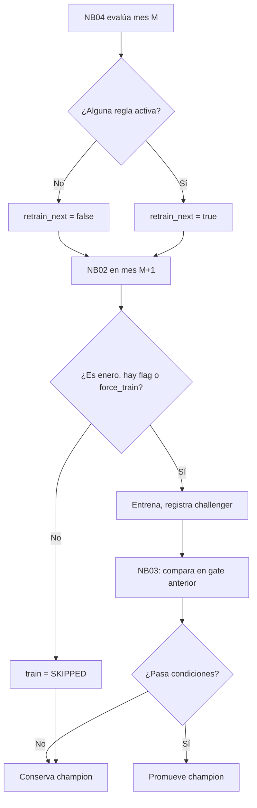

# 04 · Drift, política de reentrenamiento y promoción del champion

[← README](../README.md) · [Resultados →](05_RESULTADOS_2020.md)

## Tres preguntas diferentes

1. **¿Cambió la distribución?** PSI y KS comparan entradas del mes actual con una referencia histórica. Esto es *data drift*.
2. **¿Empeoró el modelo?** MAE/RMSE del mes y comparación con un predictor de persistencia evalúan rendimiento, no distribución.
3. **¿Debemos entrenar y promover otro modelo?** Son **dos decisiones**: NB04 solicita evaluar nuevos candidatos en el mes siguiente; NB03 decide si alguno sustituye al champion según una puerta temporal anterior al mes que se va a predecir.

## Referencia de drift

NB04 construye por estación la referencia de los **60 días anteriores** al comienzo de cada mes y la compara con entradas disponibles durante ese mes. Registra PSI y KS para:

- `pm25`, `lag_1` y `mean_6`: se informan, **no** determinan la señal de reentrenamiento.
- `anomalia = pm25 - mean_24`: variable utilizada para la alerta de *distribution shift*.

La anomalía mide desviación frente a la media de las últimas 24 horas; reduce el componente de nivel y permite observar cambios de dinámica horaria. No evita todo cambio estacional ni garantiza la calidad estadística de la prueba.

### PSI — Population Stability Index

Se calculan intervalos a partir de cuantiles de la referencia (10 intervalos inicialmente; puede haber menos al eliminar bordes repetidos), y proporciones suavizadas con **0,5** para evitar probabilidades cero. Para referencia `p_i` y mes `q_i`:

\[
PSI = \sum_i (q_i-p_i)\ln\left(\frac{q_i}{p_i}\right)
\]

El código solicita una señal `distribution_shift` si el **PSI de la anomalía es ≥ 0,20 en alguna estación**. Ese 0,20 es una decisión **didáctica** del proyecto, no un umbral normativo ni garantía universal.

### KS — Kolmogorov-Smirnov de dos muestras

NB04 reporta `ks_stat` (distancia entre distribuciones acumuladas) y `ks_pvalue`. No utiliza el valor p como activador automático. La serie horaria presenta autocorrelación y la interpretación clásica del valor p puede resultar optimista; por eso se usa como complemento exploratorio.

## Regla exacta para `retrain_next`

NB04 construye la lista `reasons`; basta **una** condición para que `retrain_next=true`:

| Código | Condición |
| --- | --- |
| `distribution_shift` | PSI de `pm25 - mean_24` ≥ 0,20 en alguna estación |
| `worse_than_persistence` | `persistence_mae > 0.1` **y** `mae > 1.10 × persistence_mae` |
| `mae_deterioration` | Existe un monitoreo previo, `mae > 1.20 × mae_previo` **y** `mae - mae_previo > 0.5` |
| `scheduled_review` | El mes monitorizado es par: febrero, abril, junio o agosto |

El valor de `retrain_next` se consume en **NB02 del mes siguiente**. Así, el flag de agosto pediría evaluar en septiembre, fuera del periodo simulado.



## Regla de promoción en NB03

El challenger se elige previamente por **menor MAE de selección** entre las familias entrenadas. NB03 usa una **puerta de promoción distinta** (la última semana anterior al mes M):

- **Con champion existente:** exigir al menos **1 % menos MAE global** (`MAE_challenger <= 0,99 × MAE_champion`) y que el MAE de ninguna estación empeore más de **5 %** frente a su champion (`MAE_challenger_est <= 1,05 × MAE_champion_est`).
- **Sin champion inicial:** comparar challenger con persistencia: mejora global ≥1 % y empeoramiento por estación ≤5 %. Si no pasa, el primer champion puede ser **persistencia**.
- Solo si procede, NB03 modifica el alias `champion` en Unity Catalog. Esto **no modifica automáticamente** la configuración del Serving endpoint.

La versión utilizada para inferencia histórica queda fijada por su número, no por resolver después un alias que pudo moverse.

## Ejemplo de interpretación: marzo y abril

En marzo, el champion v1 registró `MAE=7,570` frente a `MAE_persistencia=5,400`. También hubo drift PSI de anomalía en ambas estaciones. NB04 registró tres razones y solicitó reentrenamiento **para abril**. En abril el champion utilizado fue v5 y se registró `MAE=2,241`.

No es correcto concluir únicamente de esos dos MAE que «el reentrenamiento redujo el error 70 %» en condiciones comparables: marzo y abril contienen periodos/datos distintos, con diferentes distribuciones.

**Ejemplo contrario:** junio solicitó reentrenamiento únicamente por revisión programada y julio mantuvo la versión v8. El entrenamiento o la revisión no obligan a promover un challenger.

## Consultar las causas en Databricks

```sql
SELECT
  batch AS mes,
  get_json_object(payload, '$.model_version') AS champion_version,
  get_json_object(payload, '$.drift_signal') AS drift_anomalia,
  get_json_object(payload, '$.retrain_next') AS pedir_reentrenamiento_siguiente,
  get_json_object(payload, '$.reasons') AS motivos
FROM workspace.mlops_aire_demo_2020.gold_monitoring
ORDER BY batch;
```

Los códigos de motivos son la referencia para el reporte; no deben traducirse a una narrativa causal sin examinar mediciones, coberturas y decisiones de NB03.

[Volver al índice](../README.md)
