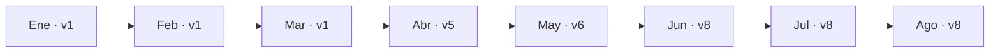

# 05 · Resultados de la simulación enero–agosto de 2020

[← README](../README.md) · [Reglas de drift](04_DRIFT_REENTRENAMIENTO_Y_PROMOCION.md) · [Guía web →](06_GUIA_DE_LA_WEB.md)

## Procedencia y alcance de los números

Estas tablas se prepararon a partir de los archivos exportados del experimento:

- `predicciones_2020.csv` ← `workspace.mlops_aire_demo_2020.gold_predictions`.
- `monitoreo_2020.csv` ← `workspace.mlops_aire_demo_2020.gold_monitoring`.

Se verificaron 8 reportes mensuales y **11.564 predicciones**. Hay 19 filas con `target_pm25` ausente y, por consiguiente, sin error calculable a nivel registro. Todas las métricas mensuales siguientes son las almacenadas por NB04; **no** se recalcularon simplemente promediando las cifras redondeadas de la tabla.

## Rendimiento del champion y PSI de anomalía

| Mes | N.º de predicciones | Champion usado | MAE | RMSE | MAE persistencia | PSI Santa Cruz | PSI San Francisco | Drift | Reentrenar siguiente |
| --- | ---: | ---: | ---: | ---: | ---: | ---: | ---: | :---: | :---: |
| Enero | 1.488 | v1 | 1,845 | 3,527 | 2,168 | 0,034 | 0,029 | No | No |
| Febrero | 1.318 | v1 | 2,661 | 3,972 | 2,745 | 0,051 | 0,182 | No | Sí |
| Marzo | 1.439 | v1 | 7,570 | 12,518 | 5,400 | 0,511 | 1,051 | Sí | Sí |
| Abril | 1.440 | v5 | 2,241 | 3,517 | 2,241 | 0,976 | 0,162 | Sí | Sí |
| Mayo | 1.463 | v6 | 1,705 | 2,582 | 1,775 | 1,107 | 0,920 | Sí | Sí |
| Junio | 1.440 | v8 | 1,714 | 2,779 | 1,794 | 0,031 | 0,110 | No | Sí |
| Julio | 1.488 | v8 | 1,695 | 2,499 | 1,815 | 0,039 | 0,036 | No | No |
| Agosto | 1.488 | v8 | 1,951 | 3,186 | 2,026 | 0,026 | 0,082 | No | Sí |

- **MAE / RMSE:** medidas de error en unidades de concentración de PM2.5; menor indica mejor ajuste en ese periodo. RMSE penaliza más errores grandes.
- **MAE persistencia:** error de predecir `PM2.5[t+1]=PM2.5[t]`, sobre las mismas observaciones evaluables.
- **PSI por estación:** se calculó sobre `pm25 - mean_24`. La condición de drift es PSI ≥0,20 en **cualquiera** de las estaciones.
- **N.º de predicciones:** cantidad de registros guardados, no cantidad de casos con etiqueta necesariamente conocida.

## Causas registradas de reentrenamiento

| Mes evaluado | Razones (`reasons`) | ¿Solicitud para mes siguiente? |
| --- | --- | :---: |
| Enero | Ninguno | No |
| Febrero | `mae_deterioration`; `scheduled_review` | Sí |
| Marzo | `distribution_shift`; `worse_than_persistence`; `mae_deterioration` | Sí |
| Abril | `distribution_shift`; `scheduled_review` | Sí |
| Mayo | `distribution_shift` | Sí |
| Junio | `scheduled_review` | Sí |
| Julio | Ninguno | No |
| Agosto | `scheduled_review` | Sí |

**Punto interpretativo:** febrero registra deterioro de MAE y revisión programada, **sin drift**. Marzo registra drift y desempeño peor que persistencia. Junio y agosto solicitan revisión programada aunque el indicador `drift_signal` sea `false`.

### Historia de versiones



En el período se observaron **tres cambios** de versión utilizada: de v1 a v5, de v5 a v6 y de v6 a v8. El número de versión **no identifica la familia del algoritmo**; para conocerla hay que consultar sus *tags* en MLflow/Unity Catalog. Tampoco garantiza que el Serving endpoint externo esté usando v8.

### Un caso que ilustra el proceso

Marzo tuvo MAE=7,570 y PSI de anomalía aproximadamente **0,511** (Santa Cruz) y **1,051** (San Francisco). Se solicitaron nuevas pruebas de entrenamiento para abril. En abril se utilizó v5 y el MAE fue 2,241. El proceso es coherente con una mejora de resultados mensuales, pero **no permite atribuir causalmente toda la diferencia al cambio de modelo**: también cambió el período y la distribución de los datos.

## Cobertura y disponibilidad

- Enero: 744 predicciones por estación.
- Febrero: 668 en San Francisco, 650 en Santa Cruz.
- Marzo: 719 en San Francisco y 720 en Santa Cruz.
- Abril: 720 por estación.
- Mayo: 744 en San Francisco y 719 en Santa Cruz.
- Junio: 720 por estación.
- Julio y agosto: 744 por estación y mes.

El panel de **consulta interactiva individual** es más restrictivo que el total de predicciones históricas: exige las 13 entradas reconstruibles sin huecos para las horas precedentes, y por eso permite **11.089 horarios**. No se interpolan vacíos para hacerlos seleccionables.

## Consultas SQL para auditar el resultado

**Integridad del ciclo:**

```sql
SELECT batch, COUNT(DISTINCT kind) AS etapas_completadas
FROM workspace.mlops_aire_demo_2020.control
WHERE batch BETWEEN '2020-01' AND '2020-08'
GROUP BY batch
ORDER BY batch;
```

Deben resultar 8 meses con **4 etapas por mes**; el evento `anchor/source` no forma parte de ese conteo.

**Métricas y razones:**

```sql
SELECT
  batch AS mes,
  ROUND(CAST(get_json_object(payload, '$.mae') AS DOUBLE), 3) AS mae,
  ROUND(CAST(get_json_object(payload, '$.rmse') AS DOUBLE), 3) AS rmse,
  get_json_object(payload, '$.model_version') AS version_usada,
  get_json_object(payload, '$.drift_signal') AS drift,
  get_json_object(payload, '$.retrain_next') AS entrenar_siguiente,
  get_json_object(payload, '$.reasons') AS motivos
FROM workspace.mlops_aire_demo_2020.gold_monitoring
ORDER BY batch;
```

**Volumen de predicciones por mes/estación:**

```sql
SELECT batch, station, COUNT(*) AS predicciones
FROM workspace.mlops_aire_demo_2020.gold_predictions
GROUP BY batch, station
ORDER BY batch, station;
```

## Conclusiones que sí permiten los datos

- Se cumplieron los ocho cierres mensuales y se registraron versiones y decisiones.
- La regla de PSI de anomalía emitió señal en marzo–mayo.
- El champion cambió de versión durante la simulación y se observaron métricas mensuales distintas.
- La política solicitó reentrenamiento por razones que incluyen desempeño y calendario, además de drift.

**No se demuestra con estos resultados**, por sí solos, que el sistema prediga bien cualquier período futuro, que v8 sea mejor que v1 bajo la **misma** distribución de evaluación o que tenga validez clínica/regulatoria.

[Volver al índice](../README.md)
